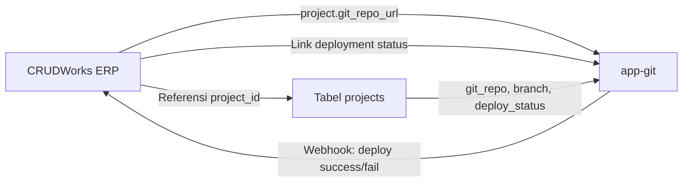

# 01 — Ringkasan Eksekutif

## Nama Produk

**CRUDWorks ERP** — Sistem ERP untuk billing, manajemen pelanggan, dan project tracking.

## Latar Belakang

CRUDWorks adalah perusahaan yang mengelola banyak pelanggan (klien) dengan berbagai layanan: hosting, domain, maintenance, custom development. Saat ini proses penagihan dan tracking project masih manual atau tersebar di spreadsheet. Diperlukan satu sistem terpusat yang mengelola seluruh siklus hidup pelanggan — dari onboarding, pembuatan project, penagihan berkala, sampai pencatatan pembayaran.

## Tujuan Produk

1. **Manajemen Pelanggan** — CRUD data klien lengkap dengan kontak, alamat, dan status aktif/nonaktif
2. **Project Tracking** — Kelola project per klien, terhubung langsung ke app-git (sistem deployment yang sudah berjalan)
3. **Invoice & Tagihan** — Buat invoice, cetak PDF, kirim via email, tracking status (draft → sent → paid → overdue)
4. **Pembayaran** — Catat pembayaran (full/partial), upload bukti transfer, rekonsiliasi otomatis
5. **Recurring Billing** — Generate invoice otomatis untuk layanan berulang (hosting bulanan, domain tahunan)
6. **Laporan Keuangan** — Aging report, revenue report, client statement

## Target Pengguna

| Role | Deskripsi | Akses Utama |
|------|-----------|-------------|
| **Super Admin** | Pemilik/pengelola CRUDWorks | Semua modul, pengaturan sistem |
| **Admin Billing** | Staff yang menangani tagihan dan pembayaran | Invoice, pembayaran, laporan, pelanggan |
| **Project Manager** | Staff yang mengelola project klien | Project, pelanggan, dashboard |
| **Viewer** | Akses read-only untuk monitoring | Dashboard, laporan (read-only) |

## Integrasi dengan app-git

Aplikasi pelanggan CRUDWorks di-deploy menggunakan sistem bernama **app-git** yang sudah berjalan di `www/app-git`. Integrasi antara CRUDWorks ERP dan app-git:

- Tabel `projects` menyimpan kolom `git_repo_url`, `git_branch`, `deploy_status`
- Dari CRUDWorks ERP, admin bisa melihat status deployment terbaru untuk setiap project
- Link langsung ke app-git untuk deploy/rollback
- Ketika project dibuat, otomatis terisi referensi ke app-git jika repo sudah ada

## Scope Versi 1.0

### Termasuk (In Scope)

- Login/logout dengan session Redis
- RBAC (role-based access control) lengkap
- CRUD pelanggan, project, layanan, invoice, pembayaran
- Recurring billing (auto-generate invoice)
- Cetak invoice PDF
- Kirim invoice via email (SMTP)
- Dashboard ringkasan piutang dan grafik
- Aging report, revenue report, client statement
- Audit trail seluruh perubahan data
- PWA (installable, offline-capable untuk read)
- Sidebar navigation Cloudflare-style
- Dark mode
- Menu layout preferences (sidebar / bottom taskbar / top taskbar)

### Tidak Termasuk (Out of Scope v1.0)

- Portal klien (self-service untuk klien lihat invoice dan bayar)
- Payment gateway integration (Midtrans, Xendit)
- Multi-currency
- Multi-company / multi-tenant
- Inventory management
- Kontrak digital / e-sign

## Metrik Keberhasilan

| Metrik | Target |
|--------|--------|
| Waktu buat invoice | < 2 menit (dari pilih klien → kirim email) |
| Invoice overdue terdeteksi | Otomatis, real-time di dashboard |
| Recurring invoice tergenerate | 100% akurat, 0 missed |
| Downtime | < 0.1% per bulan |
| Waktu load halaman | < 500ms (SPA, cached data) |
