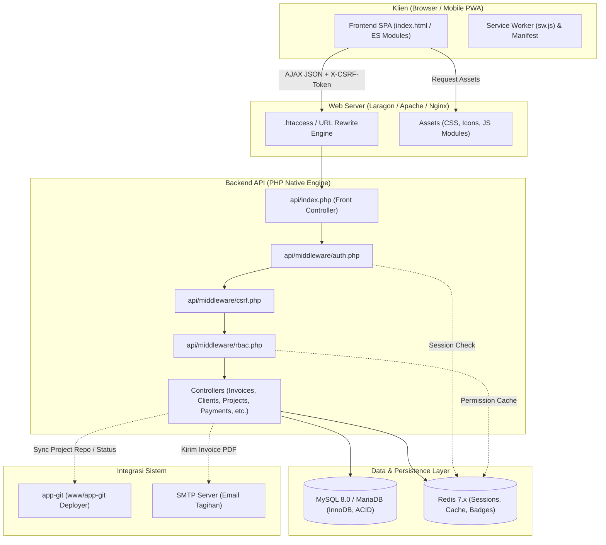

# 02 — Arsitektur Teknis

Dokumen ini mendefinisikan arsitektur sistem CRUDWorks ERP secara menyeluruh, mencakup runtime stack, struktur direktori, lifecycle request, manajemen state dan sesi berbasis Redis, serta integrasi komponen.

---

## 1. Ringkasan Arsitektur

CRUDWorks ERP dibangun menggunakan pola **Lightweight Modular Monolith**:
- **Backend**: Native Object-Oriented PHP 8.1+ tanpa framework (tanpa Laravel/Symfony). Front Controller tunggal (`api/index.php`), koneksi MySQL menggunakan PDO dengan prepared statements dan transaksi ACID, serta Redis untuk caching dan penyimpanan sesi.
- **Frontend SPA**: Vanilla JavaScript (ES6+ Modules) murni tanpa build step (tanpa Webpack/Vite). Navigasi berbasis hash routing (`#/invoices`, `#/clients`) dengan lazy-load controller per halaman.
- **Styling**: TailwindCSS utility-first via CDN dengan custom design tokens, dark mode toggle, dan 3 pilihan layout navigasi (Cloudflare Sidebar, Windows Bottom Taskbar, Windows Top Taskbar).
- **Security & PWA**: Validasi CSRF berbasis token per sesi, proteksi RBAC hierarkis bersumber dari `menus.json` dan database, serta Service Worker PWA (`sw.js`) untuk offline caching shell aplikasi.

---

## 2. Diagram Topologi Sistem



---

## 3. Struktur Direktori Proyek

```
d:/laragon/www/crudworks-home/
├── .htaccess                   # Rewrite engine & security headers
├── .env.example                # Template konfigurasi environment
├── database.sql                # Skema DDL & seed data inisial
├── index.php                   # Entry point PHP, injeksi versi & minifikasi shell
├── index.html                  # Shell SPA: layout, dock, splash screen, modal
├── manifest.json               # Konfigurasi PWA Installable
├── sw.js                       # Service worker PWA & offline cache
├── CHANGELOG.md                # Riwayat perubahan format Keep-a-Changelog
├── api/
│   ├── .htaccess               # Proteksi akses & routing ke index.php
│   ├── index.php               # Front controller API & endpoint dispatcher
│   ├── config/
│   │   ├── env.php             # Parser file .env sederhana
│   │   ├── app.php             # Konstanta sistem & versi
│   │   ├── database.php        # Singleton PDO koneksi MySQL
│   │   ├── redis.php           # Singleton koneksi Redis & helper session
│   │   ├── menus.json          # Struktur master menu navigasi & kode permission
│   │   └── invoice_helpers.php # Format IDR, kalkulasi pajak, nomor tagihan
│   ├── middleware/
│   │   ├── auth.php            # Verifikasi user session aktif
│   │   ├── csrf.php            # Verifikasi & regenerasi token CSRF
│   │   └── rbac.php            # Filter akses role dan validasi menu dinamis
│   └── controllers/
│       ├── AuthController.php          # Login, logout, check session
│       ├── DashboardController.php     # Agregasi piutang, statistik, overdue
│       ├── ClientController.php        # CRUD master pelanggan
│       ├── ProjectController.php       # CRUD project & bridge ke app-git
│       ├── ServiceController.php       # Master katalog layanan/paket
│       ├── InvoiceController.php       # Buat, update, cetak PDF, kirim email
│       ├── PaymentController.php       # Catat bayar, histori, rekonsiliasi
│       ├── RecurringController.php     # Otomasi tagihan berulang
│       ├── ReportController.php        # Laporan aging, omset, ledger klien
│       ├── UserController.php          # Manajemen akun operator
│       ├── RoleController.php          # Manajemen role & hak akses
│       ├── SettingsController.php      # Konfigurasi instansi, template, SMTP
│       ├── AuditController.php         # Audit trail aktivitas pengguna
│       └── NotificationController.php  # Notifikasi status tagihan & overdue
├── assets/
│   ├── css/
│   │   └── app.css             # Desain kustom, komponen Cloudflare dock, print style
│   ├── js/
│   │   ├── app.js              # SPA Core: Router, API client, State, UI Manager
│   │   └── pages/              # ES Modules spesifik per rute/halaman
│   │       ├── dashboard.js
│   │       ├── clients.js
│   │       ├── projects.js
│   │       ├── services.js
│   │       ├── invoices.js
│   │       ├── payments.js
│   │       ├── recurring.js
│   │       ├── reports.js
│   │       ├── users.js
│   │       ├── roles.js
│   │       ├── settings.js
│   │       └── audit.js
│   └── icons/                  # Aset ikon PWA (PNG & SVG)
└── docs/
    ├── AGENTS.md               # Instruksi dan standar kerja AI Agent
    └── prd/                    # Dokumentasi spesifikasi sistem lengkap
```

---

## 4. Siklus Hidup Permintaan (Request Lifecycle)

1. **Inisialisasi Shell**: Klien membuka URL root. `index.php` mengekstrak versi aplikasi dari `CHANGELOG.md`, membaca `index.html`, menyematkan versi pada tag script/link untuk cache-busting, dan mengirimkan HTML shell ke browser.
2. **Booting SPA**: Browser mengeksekusi `assets/js/app.js`. `App.init()` melakukan pemeriksaan sesi via `GET /api/auth/check`.
   - Jika belum terautentikasi: UI login ditampilkan.
   - Jika sudah terautentikasi: Token CSRF diambil, menu navigasi dinamis dimuat dari `GET /api/menus`, sidebar dirender, dan rute hash saat ini dimuat.
3. **Dispatching API**: Permintaan AJAX dikirim ke `api/{resource}` via `fetch()` di dalam `App.api()`.
   - Header `X-CSRF-Token` otomatis disematkan pada method `POST`, `PUT`, dan `DELETE`.
   - `api/index.php` memverifikasi CSRF, memastikan validitas sesi, mengecek RBAC, dan mengarahkan ke controller terkait.
4. **Optimasi Concurrency PHP**: Pada permintaan `GET` (read-only), sistem memanggil `session_write_close()` sesegera mungkin agar proses AJAX paralel dari tab/komponen yang sama tidak saling menunggu kunci sesi (lock).

---

## 5. Manajemen Sesi dan Cache Berbasis Redis

Untuk mencegah overhead disk I/O dan menangani proses berulang:
- **Redis Session Handler**: Sesi PHP disimpan langsung ke Redis (`tcp://127.0.0.1:6379`) dengan prefix key `crudworks_sess:`.
- **Cache-Aside Data Master**: Master data (katalog layanan, daftar role, struktur menu RBAC, konfigurasi instansi) di-cache di Redis dengan TTL 1 jam.
- **Invalidasi Cache Bertarget**: Setiap kali terjadi operasi CUD (Create/Update/Delete) pada modul terkait, fungsi `clearCache(['services', 'rbac', 'settings'])` membersihkan key terkait secara terarah.
- **Badge Notifikasi Otomatis**: Jumlah tagihan jatuh tempo dan pembayaran tertunda dihitung dan di-cache selama 30 detik untuk menghemat beban query database saat navigasi berpindah-pindah.

---

## 6. Pola Keamanan Data

- **SQL Injection**: Seluruh query database wajib memakai PDO prepared statements dengan parameter terikat (`?` atau named placeholder).
- **Cross-Site Scripting (XSS)**: Semua output HTML di frontend di-escape via helper `App.escapeHtml()` sebelum diinjeksi ke DOM.
- **Cross-Site Request Forgery (CSRF)**: Token 64-karakter acak dihasilkan dari `random_bytes(32)`, disimpan di sesi, dan dicocokkan menggunakan `hash_equals()`.
- **Role-Based Access Control (RBAC)**: Setiap endpoint controller mengeksekusi `checkPermission('permission.code')` sebelum melakukan pengolahan data. User dengan role ID 1 (Super Admin) memiliki bypass otomatis.
- **Audit Logging**: Perubahan data kritis (membuat invoice, mengubah status tagihan, memverifikasi pembayaran) mencatat user ID, IP address, user-agent, data lama, dan data baru ke tabel `audit_logs`.
