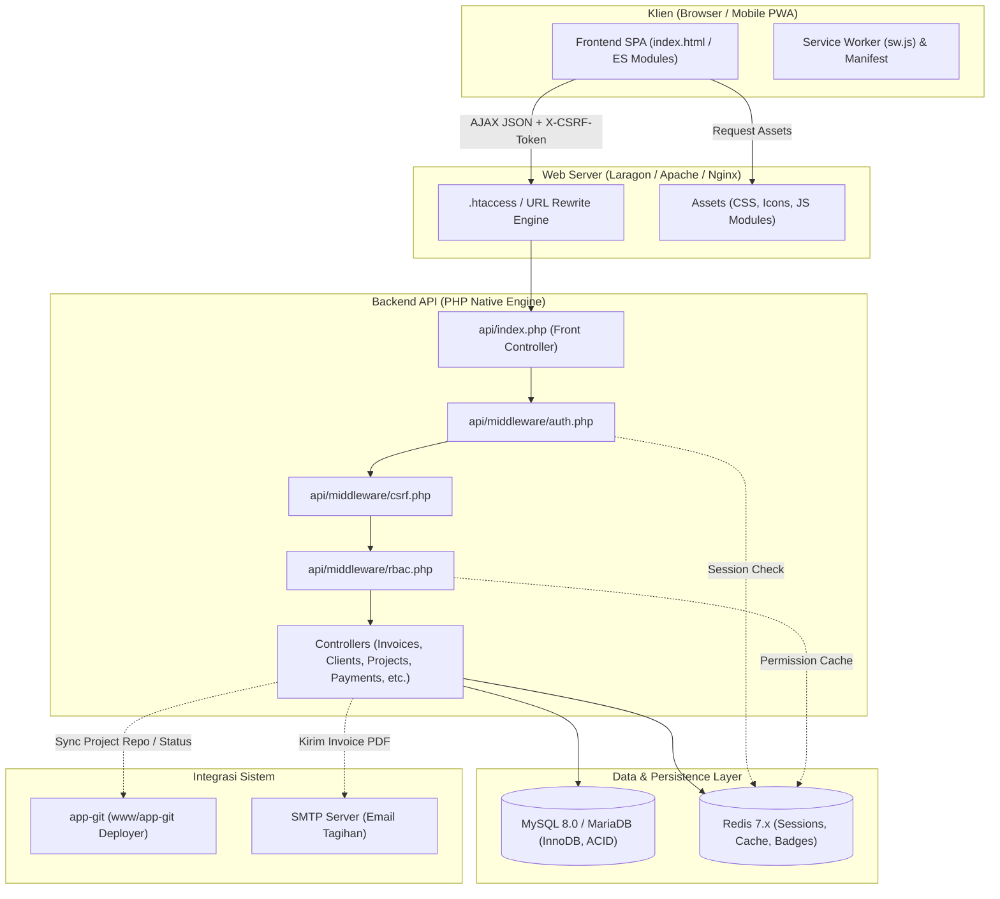

# 02 — Arsitektur Teknis

Dokumen ini mendefinisikan arsitektur sistem CRUDWorks ERP secara menyeluruh, mencakup runtime stack, struktur direktori, lifecycle request, manajemen state dan sesi berbasis Redis, serta integrasi komponen.

---

## 1. Ringkasan Arsitektur

CRUDWorks ERP dibangun menggunakan pola **Lightweight Modular Monolith**:
- **Backend**: Native Object-Oriented PHP 8.1+ tanpa framework (tanpa Laravel/Symfony). Front Controller tunggal (`api/index.php`), koneksi MySQL menggunakan PDO dengan prepared statements dan transaksi ACID, serta Redis untuk caching dan penyimpanan sesi.
- **Frontend SPA**: Vanilla JavaScript (ES6+ Modules) murni tanpa build step (tanpa Webpack/Vite). Navigasi berbasis hash routing (`#/invoices`, `#/clients`) dengan lazy-load controller per halaman.
- **Styling**: TailwindCSS utility-first via CDN dengan custom design tokens, dark mode toggle, dan 3 pilihan layout navigasi (Cloudflare Sidebar, Windows Bottom Taskbar, Windows Top Taskbar).
- **Security & PWA**: Validasi CSRF berbasis token per sesi, proteksi RBAC hierarkis bersumber dari `menus.json` dan database, serta Service Worker PWA (`sw.js`) untuk offline caching shell aplikasi.

---

## 2. Diagram Topologi Sistem



---

## 3. Struktur Direktori Proyek

```
d:/laragon/www/crudworks-home/
├── .htaccess                   # Rewrite engine & security headers
├── .env.example                # Template konfigurasi environment
├── database.sql                # Skema DDL & seed data inisial
├── index.php                   # Entry point PHP, injeksi versi & minifikasi shell
├── index.html                  # Shell SPA: layout, dock, splash screen, modal
├── manifest.json               # Konfigurasi PWA Installable
├── sw.js                       # Service worker PWA & offline cache
├── CHANGELOG.md                # Riwayat perubahan format Keep-a-Changelog
├── api/
│   ├── .htaccess               # Proteksi akses & routing ke index.php
│   ├── index.php               # Front controller API & endpoint dispatcher
│   ├── config/
│   │   ├── env.php             # Parser file .env sederhana
│   │   ├── app.php             # Konstanta sistem & versi
│   │   ├── database.php        # Singleton PDO koneksi MySQL
│   │   ├── redis.php           # Singleton koneksi Redis & helper session
│   │   ├── menus.json          # Struktur master menu navigasi & kode permission
│   │   └── invoice_helpers.php # Format IDR, kalkulasi pajak, nomor tagihan
│   ├── middleware/
│   │   ├── auth.php            # Verifikasi user session aktif
│   │   ├── csrf.php            # Verifikasi & regenerasi token CSRF
│   │   └── rbac.php            # Filter akses role dan validasi menu dinamis
│   └── controllers/
│       ├── AuthController.php          # Login, logout, check session
│       ├── DashboardController.php     # Agregasi piutang, statistik, overdue
│       ├── ClientController.php        # CRUD master pelanggan
│       ├── ProjectController.php       # CRUD project & bridge ke app-git
│       ├── ServiceController.php       # Master katalog layanan/paket
│       ├── InvoiceController.php       # Buat, update, cetak PDF, kirim email
│       ├── PaymentController.php       # Catat bayar, histori, rekonsiliasi
│       ├── RecurringController.php     # Otomasi tagihan berulang
│       ├── ReportController.php        # Laporan aging, omset, ledger klien
│       ├── UserController.php          # Manajemen akun operator
│       ├── RoleController.php          # Manajemen role & hak akses
│       ├── SettingsController.php      # Konfigurasi instansi, template, SMTP
│       ├── AuditController.php         # Audit trail aktivitas pengguna
│       └── NotificationController.php  # Notifikasi status tagihan & overdue
├── assets/
│   ├── css/
│   │   └── app.css             # Desain kustom, komponen Cloudflare dock, print style
│   ├── js/
│   │   ├── app.js              # SPA Core: Router, API client, State, UI Manager
│   │   └── pages/              # ES Modules spesifik per rute/halaman
│   │       ├── dashboard.js
│   │       ├── clients.js
│   │       ├── projects.js
│   │       ├── services.js
│   │       ├── invoices.js
│   │       ├── payments.js
│   │       ├── recurring.js
│   │       ├── reports.js
│   │       ├── users.js
│   │       ├── roles.js
│   │       ├── settings.js
│   │       └── audit.js
│   └── icons/                  # Aset ikon PWA (PNG & SVG)
└── docs/
    ├── AGENTS.md               # Instruksi dan standar kerja AI Agent
    └── prd/                    # Dokumentasi spesifikasi sistem lengkap
```

---

## 4. Siklus Hidup Permintaan (Request Lifecycle)

1. **Inisialisasi Shell**: Klien membuka URL root. `index.php` mengekstrak versi aplikasi dari `CHANGELOG.md`, membaca `index.html`, menyematkan versi pada tag script/link untuk cache-busting, dan mengirimkan HTML shell ke browser.
2. **Booting SPA**: Browser mengeksekusi `assets/js/app.js`. `App.init()` melakukan pemeriksaan sesi via `GET /api/auth/check`.
   - Jika belum terautentikasi: UI login ditampilkan.
   - Jika sudah terautentikasi: Token CSRF diambil, menu navigasi dinamis dimuat dari `GET /api/menus`, sidebar dirender, dan rute hash saat ini dimuat.
3. **Dispatching API**: Permintaan AJAX dikirim ke `api/{resource}` via `fetch()` di dalam `App.api()`.
   - Header `X-CSRF-Token` otomatis disematkan pada method `POST`, `PUT`, dan `DELETE`.
   - `api/index.php` memverifikasi CSRF, memastikan validitas sesi, mengecek RBAC, dan mengarahkan ke controller terkait.
4. **Optimasi Concurrency PHP**: Pada permintaan `GET` (read-only), sistem memanggil `session_write_close()` sesegera mungkin agar proses AJAX paralel dari tab/komponen yang sama tidak saling menunggu kunci sesi (lock).

---

## 5. Manajemen Sesi dan Cache Berbasis Redis

Untuk mencegah overhead disk I/O dan menangani proses berulang:
- **Redis Session Handler**: Sesi PHP disimpan langsung ke Redis (`tcp://127.0.0.1:6379`) dengan prefix key `crudworks_sess:`.
- **Cache-Aside Data Master & Laporan Berat**:
  - Master data (katalog layanan, daftar role, struktur menu RBAC, konfigurasi instansi) dan statistik dashboard di-cache di Redis.
  - Seluruh laporan agregasi berat di `ReportController.php` (`aging`, `revenue`, `statement`, `profit-loss`, `cashflow-tax`) dan laporan akuntansi di `AccountingController.php` (`coa`, `ledger`, `balance-sheet`, `trial-balance`, `income-statement`, `cash-flow`, `equity-statement`) terintegrasi dengan helper terpadu `initReportCache()` (TTL default 300 detik, mendukung bypass `?fresh=1`).
- **Invalidasi Cache Bertarget**: Setiap kali terjadi operasi CUD (Create/Update/Delete) pada faktur, pembayaran, pengeluaran, jurnal, COA, atau pengaturan, fungsi `clearCache()` membersihkan key terkait (`cache_report_*`, `cache_accounting_*`, `dashboard_stats`, dll.) secara otomatis, serta tersedia tombol pembersihan manual di **Pengaturan Sistem → Kesehatan Sistem & Cache**.
- **Fallback Aman**: Apabila server/ekstensi Redis tidak aktif, `RedisManager` otomatis melakukan fallback ke query MySQL tanpa mengganggu operasional.
- **Badge Notifikasi Otomatis**: Jumlah tagihan jatuh tempo dan pembayaran tertunda dihitung dan di-cache selama 30 detik untuk menghemat beban query database saat navigasi berpindah-pindah.

---

## 7. Standar Fungsi Terpadu & Aturan Kebersihan Kode

Untuk mencegah duplikasi kode lintas modul, pengembangan wajib mematuhi 7 aturan rekayasa berikut:
1. **Satu Sumber Kebenaran Status & Badge**: Warna, label, dan ikon status wajib mengacu pada pemetaan terpusat (`App.renderStatusBadge()`), bukan mendefinisikan ulang objek badge di setiap halaman JS.
2. **Wajib `paginatedResponse()` di Endpoint Daftar**: Seluruh endpoint `GET` berpaginasi wajib memakai `paginatedResponse()` di `api/index.php`—dilarang menghitung `LIMIT`/`OFFSET` dan menyusun JSON `pagination` secara manual.
3. **Helper Validasi Input & Enum Terpadu**: Pengecekan field wajib dan validasi `ENUM` di backend wajib memakai `requireParams()` dan `validateEnum()` di `api/index.php`.
4. **Binding Event di `container` & Debounce Standar**: Event listener SPA dipasang di dalam `container` (atau sekali di level modul) agar tidak menumpuk ganda saat berpindah rute, dan pencarian teks wajib memakai `App.debounce()`.
5. **Batas Ukuran Modul & Pemisahan Helper**: Controller atau halaman JS yang melebihi ~500 baris atau memuat logika kompleks (PDF, akuntansi, integrasi) wajib dipecah ke `api/config/*_helpers.php` atau `assets/js/core/*.js`.
6. **Sinkronisasi Wajib Skema DB & Cache PWA**: Setiap perubahan skema SQL wajib langsung dicatat di `database.sql` dan `docs/prd/03-desain-database.md`; setiap perubahan JS/CSS wajib menaikkan `CACHE_NAME` di `sw.js` (atau `portal/sw.js`).
7. **Satu Pintu Modal & Konfirmasi**: Seluruh dialog konfirmasi dan modal ringkas wajib memakai `App.confirm()` / `App.modal()` atau komponen modal standar—dilarang memakai `alert()`, `confirm()`, `prompt()` bawaan browser.

Ringkasan helper terpadu yang tersedia:
- **Backend (`api/index.php` & `api/config/invoice_helpers.php`)**: `generateDocNumber()`, `initReportCache()`, `cacheGet()`, `cacheSet()`, `clearCache()`, `requireParams()`, `validateEnum()`, `saveUploadedFile()`.
- **Frontend (`assets/js/core/utils.js` & `assets/js/app.js`)**: `App.renderPagination()`, `App.openWhatsApp()`, `App.formatWhatsAppPhone()`, `App.exportCsv()`, `App.renderStatusBadge()`, `App.debounce()`, `App.btnLoading()`, `App.formatIDR()`, `App.formatDate()`.

---

## 8. Standar Keamanan, Integritas Keuangan & Isolasi Data

1. **Upload File & Lampiran Terpusat**: Seluruh unggahan file wajib melewati helper terpadu `saveUploadedFile()` yang memvalidasi MIME type asli (`finfo`), batas ukuran file, dan menghasilkan nama file acak (`random_bytes`).
2. **Anti Double-Submit & Idempotency Transaksi**: Tombol aksi mutasi di frontend wajib memakai `App.btnLoading()`, dan backend wajib menolak konversi ganda (misal tiket yang sudah memiliki `invoice_id` atau `quotation_id`).
3. **Presisi Desimal Keuangan**: Kolom uang memakai `DECIMAL(15,2)` dan pembulatan `round($val, 2)` di PHP dengan toleransi pelunasan `<= 0.01`.
4. **Isolasi Ketat Data Publik**: Endpoint publik (`public-invoice`, `public-quotation`, `public-status`, `portal-auth`) wajib memakai *explicit `SELECT`* dan dilarang membocorkan `catatan_internal`, kredensial, atau data klien lain.
5. **Proteksi Penghapusan Data Transaksi**: Faktur `lunas` atau yang sudah memiliki pembayaran, pembayaran terverifikasi, kontrak ditandatangani, dan jurnal tutup buku dilarang dihapus permanen (`DELETE`); arahkan ke pembatalan (`batal`) atau nonaktif.
6. **Pesan Error Ramah Pengguna**: Respons `errorResponse()` untuk pengguna harus berbahasa Indonesia yang jelas dan tidak membocorkan detail SQL atau path internal server pada mode produksi.

---

## 9. Tata Kelola Migrasi, Rilis & Definisi Selesai (DoD)

1. **Migrasi Skema Database Aman**: Penambahan kolom atau tabel baru pada database aktif wajib bersifat *backward-compatible* (`NULL` atau `DEFAULT` aman) dan memeriksa keberadaan kolom sebelum `ALTER TABLE`.
2. **Standar Penamaan Permission RBAC**: Setiap modul/endpoint baru wajib memakai konvensi `<domain>.view|create|edit|delete|manage` dan didaftarkan serentak di `api/config/menus.json`, tabel `permissions`, serta `role_permissions`.
3. **Transaksi Multi-Tabel & Urutan Cache**: Mutasi lebih dari satu tabel wajib memakai transaksi PDO (`beginTransaction` / `commit` / `rollBack`), dan `clearCache()` serta `logActivity()` wajib dipanggil **setelah `$pdo->commit()` berhasil**.
4. **Standar Responsivitas, Dark Mode & Aksesibilitas**: Seluruh UI baru wajib mendukung `dark:*`, tata letak mobile hingga desktop (`overflow-x-auto` pada tabel), serta `title` atau `aria-label` pada tombol ikon.
5. **Definition of Done (Gerbang Verifikasi)**: Perubahan dinyatakan selesai hanya setelah lulus `php -l` (seluruh file PHP diubah), `node -c` (seluruh file JS diubah), validasi JSON konfigurasi, dan uji muat live tanpa PHP Warning atau Console Error.
6. **Kebijakan Catatan Rilis Pelanggan**: Fitur yang berdampak ke pengguna akhir wajib dicatat di `CHANGELOG.md` dengan bahasa pelanggan yang menjelaskan manfaat operasionalnya.

---

## 6. Pola Keamanan Data

- **SQL Injection**: Seluruh query database wajib memakai PDO prepared statements dengan parameter terikat (`?` atau named placeholder).
- **Cross-Site Scripting (XSS)**: Semua output HTML di frontend di-escape via helper `App.escapeHtml()` sebelum diinjeksi ke DOM.
- **Cross-Site Request Forgery (CSRF)**: Token 64-karakter acak dihasilkan dari `random_bytes(32)`, disimpan di sesi, dan dicocokkan menggunakan `hash_equals()`.
- **Role-Based Access Control (RBAC)**: Setiap endpoint controller mengeksekusi `checkPermission('permission.code')` sebelum melakukan pengolahan data. User dengan role ID 1 (Super Admin) memiliki bypass otomatis.
- **Audit Logging**: Perubahan data kritis (membuat invoice, mengubah status tagihan, memverifikasi pembayaran) mencatat user ID, IP address, user-agent, data lama, dan data baru ke tabel `audit_logs`.
