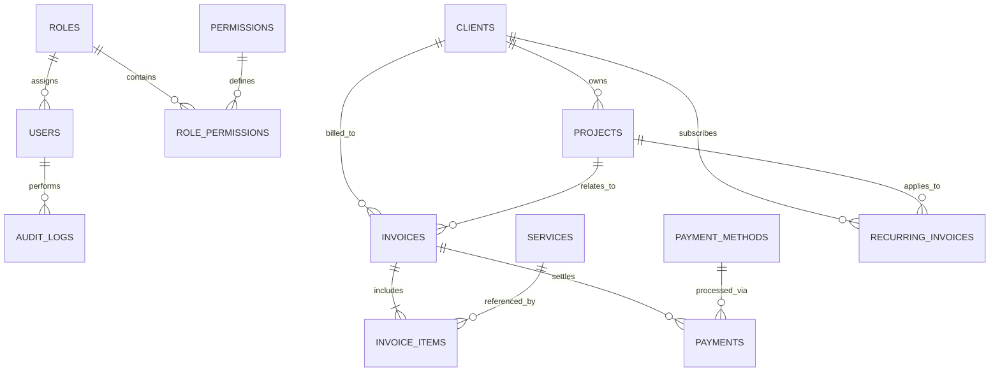

# 03 — Desain Database

Dokumen ini memuat skema relasional lengkap untuk CRUDWorks ERP, tipe data kolom, indeks performa, foreign key constraint, serta seed data awal.

---

## 1. Diagram Relasi Entitas (ERD)



---

## 2. Definisi Tabel

### 2.1 Manajemen Akses & Pengguna

#### Tabel `roles`
Menyimpan tingkatan peran akses dalam sistem.
```sql
CREATE TABLE IF NOT EXISTS `roles` (
    `id` INT UNSIGNED AUTO_INCREMENT PRIMARY KEY,
    `name` VARCHAR(50) NOT NULL UNIQUE,
    `label` VARCHAR(100) NOT NULL,
    `description` VARCHAR(255) NULL,
    `created_at` DATETIME DEFAULT CURRENT_TIMESTAMP,
    `updated_at` DATETIME DEFAULT CURRENT_TIMESTAMP ON UPDATE CURRENT_TIMESTAMP
) ENGINE=InnoDB DEFAULT CHARSET=utf8mb4 COLLATE=utf8mb4_unicode_ci;
```

#### Tabel `permissions`
Menyimpan kode otoritas per fitur aplikasi.
```sql
CREATE TABLE IF NOT EXISTS `permissions` (
    `id` INT UNSIGNED AUTO_INCREMENT PRIMARY KEY,
    `kode` VARCHAR(100) NOT NULL UNIQUE,
    `nama` VARCHAR(100) NOT NULL,
    `kategori` VARCHAR(50) NOT NULL,
    `keterangan` VARCHAR(255) NULL,
    `created_at` DATETIME DEFAULT CURRENT_TIMESTAMP
) ENGINE=InnoDB DEFAULT CHARSET=utf8mb4 COLLATE=utf8mb4_unicode_ci;
```

#### Tabel `role_permissions`
Relasi many-to-many antara role dan permission.
```sql
CREATE TABLE IF NOT EXISTS `role_permissions` (
    `role_id` INT UNSIGNED NOT NULL,
    `permission_id` INT UNSIGNED NOT NULL,
    PRIMARY KEY (`role_id`, `permission_id`),
    CONSTRAINT `fk_rp_role` FOREIGN KEY (`role_id`) REFERENCES `roles` (`id`) ON DELETE CASCADE,
    CONSTRAINT `fk_rp_perm` FOREIGN KEY (`permission_id`) REFERENCES `permissions` (`id`) ON DELETE CASCADE
) ENGINE=InnoDB DEFAULT CHARSET=utf8mb4 COLLATE=utf8mb4_unicode_ci;
```

#### Tabel `users`
Menyimpan kredensial dan profil operator/admin.
```sql
CREATE TABLE IF NOT EXISTS `users` (
    `id` INT UNSIGNED AUTO_INCREMENT PRIMARY KEY,
    `role_id` INT UNSIGNED NOT NULL,
    `username` VARCHAR(50) NOT NULL UNIQUE,
    `password` VARCHAR(255) NOT NULL,
    `nama_lengkap` VARCHAR(100) NOT NULL,
    `email` VARCHAR(100) NOT NULL UNIQUE,
    `telepon` VARCHAR(30) NULL,
    `avatar` VARCHAR(255) NULL,
    `status` ENUM('aktif', 'nonaktif') DEFAULT 'aktif',
    `preferences_json` TEXT NULL,
    `last_login` DATETIME NULL,
    `created_at` DATETIME DEFAULT CURRENT_TIMESTAMP,
    `updated_at` DATETIME DEFAULT CURRENT_TIMESTAMP ON UPDATE CURRENT_TIMESTAMP,
    CONSTRAINT `fk_users_role` FOREIGN KEY (`role_id`) REFERENCES `roles` (`id`) ON UPDATE CASCADE
) ENGINE=InnoDB DEFAULT CHARSET=utf8mb4 COLLATE=utf8mb4_unicode_ci;
```

---

### 2.2 Entitas Bisnis & Operasional Pelanggan

#### Tabel `clients`
Menyimpan data master pelanggan/organisasi klien.
```sql
CREATE TABLE IF NOT EXISTS `clients` (
    `id` INT UNSIGNED AUTO_INCREMENT PRIMARY KEY,
    `kode_klien` VARCHAR(30) NOT NULL UNIQUE,
    `nama_perusahaan` VARCHAR(150) NOT NULL,
    `penanggung_jawab` VARCHAR(100) NOT NULL,
    `email` VARCHAR(100) NOT NULL,
    `telepon` VARCHAR(30) NOT NULL,
    `alamat` TEXT NULL,
    `kota` VARCHAR(100) NULL,
    `npwp` VARCHAR(50) NULL,
    `catatan` TEXT NULL,
    `status` ENUM('aktif', 'prospek', 'nonaktif') DEFAULT 'aktif',
    `created_at` DATETIME DEFAULT CURRENT_TIMESTAMP,
    `updated_at` DATETIME DEFAULT CURRENT_TIMESTAMP ON UPDATE CURRENT_TIMESTAMP,
    INDEX `idx_clients_status` (`status`),
    INDEX `idx_clients_nama` (`nama_perusahaan`)
) ENGINE=InnoDB DEFAULT CHARSET=utf8mb4 COLLATE=utf8mb4_unicode_ci;
```

#### Tabel `projects`
Menyimpan daftar project aktif yang dikerjakan, terhubung ke repositori app-git.
```sql
CREATE TABLE IF NOT EXISTS `projects` (
    `id` INT UNSIGNED AUTO_INCREMENT PRIMARY KEY,
    `client_id` INT UNSIGNED NOT NULL,
    `kode_project` VARCHAR(30) NOT NULL UNIQUE,
    `nama_project` VARCHAR(150) NOT NULL,
    `deskripsi` TEXT NULL,
    `git_repo_url` VARCHAR(255) NULL,
    `git_branch` VARCHAR(50) DEFAULT 'main',
    `deploy_path` VARCHAR(255) NULL,
    `app_url` VARCHAR(255) NULL,
    `last_deploy_status` ENUM('idle', 'success', 'failed', 'running') DEFAULT 'idle',
    `last_deploy_at` DATETIME NULL,
    `tanggal_mulai` DATE NULL,
    `tanggal_selesai` DATE NULL,
    `nilai_project` DECIMAL(15,2) DEFAULT 0.00,
    `status` ENUM('perencanaan', 'aktif', 'maintenance', 'selesai', 'dibatalkan') DEFAULT 'aktif',
    `created_at` DATETIME DEFAULT CURRENT_TIMESTAMP,
    `updated_at` DATETIME DEFAULT CURRENT_TIMESTAMP ON UPDATE CURRENT_TIMESTAMP,
    CONSTRAINT `fk_projects_client` FOREIGN KEY (`client_id`) REFERENCES `clients` (`id`) ON DELETE CASCADE,
    INDEX `idx_projects_status` (`status`)
) ENGINE=InnoDB DEFAULT CHARSET=utf8mb4 COLLATE=utf8mb4_unicode_ci;
```

#### Tabel `services`
Katalog layanan standar yang disediakan CRUDWorks (misal: Hosting Cloud, Maintenance Bulanan, Perpanjangan Domain, Dev Sprint).
```sql
CREATE TABLE IF NOT EXISTS `services` (
    `id` INT UNSIGNED AUTO_INCREMENT PRIMARY KEY,
    `kode_layanan` VARCHAR(30) NOT NULL UNIQUE,
    `nama_layanan` VARCHAR(100) NOT NULL,
    `kategori` ENUM('hosting', 'domain', 'maintenance', 'development', 'konsultasi', 'lainnya') DEFAULT 'hosting',
    `deskripsi` TEXT NULL,
    `harga_standar` DECIMAL(15,2) NOT NULL DEFAULT 0.00,
    `siklus_tagihan` ENUM('one_time', 'bulanan', 'triwulan', 'semester', 'tahunan') DEFAULT 'bulanan',
    `status` ENUM('aktif', 'nonaktif') DEFAULT 'aktif',
    `created_at` DATETIME DEFAULT CURRENT_TIMESTAMP,
    `updated_at` DATETIME DEFAULT CURRENT_TIMESTAMP ON UPDATE CURRENT_TIMESTAMP
) ENGINE=InnoDB DEFAULT CHARSET=utf8mb4 COLLATE=utf8mb4_unicode_ci;
```

---

### 2.3 Tagihan, Item, dan Pembayaran

#### Tabel `invoices`
Header data faktur/tagihan pelanggan.
```sql
CREATE TABLE IF NOT EXISTS `invoices` (
    `id` INT UNSIGNED AUTO_INCREMENT PRIMARY KEY,
    `nomor_invoice` VARCHAR(50) NOT NULL UNIQUE,
    `client_id` INT UNSIGNED NOT NULL,
    `project_id` INT UNSIGNED NULL,
    `tanggal_invoice` DATE NOT NULL,
    `tanggal_jatuh_tempo` DATE NOT NULL,
    `subtotal` DECIMAL(15,2) NOT NULL DEFAULT 0.00,
    `diskon_tipe` ENUM('nominal', 'persen') DEFAULT 'nominal',
    `diskon_nilai` DECIMAL(15,2) DEFAULT 0.00,
    `pajak_persen` DECIMAL(5,2) DEFAULT 0.00,
    `pajak_nominal` DECIMAL(15,2) DEFAULT 0.00,
    `total_tagihan` DECIMAL(15,2) NOT NULL DEFAULT 0.00,
    `total_dibayar` DECIMAL(15,2) NOT NULL DEFAULT 0.00,
    `sisa_tagihan` DECIMAL(15,2) NOT NULL DEFAULT 0.00,
    `status` ENUM('draft', 'dikirim', 'sebagian', 'lunas', 'jatuh_tempo', 'batal') DEFAULT 'draft',
    `catatan_klien` TEXT NULL,
    `catatan_internal` TEXT NULL,
    `email_terkirim_at` DATETIME NULL,
    `last_sent_at` DATETIME NULL,
    `last_sent_via` VARCHAR(30) NULL,
    `created_by` INT UNSIGNED NOT NULL,
    `created_at` DATETIME DEFAULT CURRENT_TIMESTAMP,
    `updated_at` DATETIME DEFAULT CURRENT_TIMESTAMP ON UPDATE CURRENT_TIMESTAMP,
    CONSTRAINT `fk_invoices_client` FOREIGN KEY (`client_id`) REFERENCES `clients` (`id`) ON UPDATE CASCADE,
    CONSTRAINT `fk_invoices_project` FOREIGN KEY (`project_id`) REFERENCES `projects` (`id`) ON DELETE SET NULL,
    CONSTRAINT `fk_invoices_user` FOREIGN KEY (`created_by`) REFERENCES `users` (`id`) ON UPDATE CASCADE,
    INDEX `idx_invoices_status` (`status`),
    INDEX `idx_invoices_jatuh_tempo` (`tanggal_jatuh_tempo`),
    INDEX `idx_invoices_client` (`client_id`)
) ENGINE=InnoDB DEFAULT CHARSET=utf8mb4 COLLATE=utf8mb4_unicode_ci;
```

#### Tabel `invoice_items`
Rincian baris layanan/produk di dalam sebuah invoice.
```sql
CREATE TABLE IF NOT EXISTS `invoice_items` (
    `id` INT UNSIGNED AUTO_INCREMENT PRIMARY KEY,
    `invoice_id` INT UNSIGNED NOT NULL,
    `service_id` INT UNSIGNED NULL,
    `deskripsi` VARCHAR(255) NOT NULL,
    `kuantitas` DECIMAL(10,2) NOT NULL DEFAULT 1.00,
    `harga_satuan` DECIMAL(15,2) NOT NULL DEFAULT 0.00,
    `total_harga` DECIMAL(15,2) NOT NULL DEFAULT 0.00,
    `created_at` DATETIME DEFAULT CURRENT_TIMESTAMP,
    CONSTRAINT `fk_items_invoice` FOREIGN KEY (`invoice_id`) REFERENCES `invoices` (`id`) ON DELETE CASCADE,
    CONSTRAINT `fk_items_service` FOREIGN KEY (`service_id`) REFERENCES `services` (`id`) ON DELETE SET NULL
) ENGINE=InnoDB DEFAULT CHARSET=utf8mb4 COLLATE=utf8mb4_unicode_ci;
```

#### Tabel `payment_methods`
Daftar rekening bank / kanal penerimaan pembayaran instansi.
```sql
CREATE TABLE IF NOT EXISTS `payment_methods` (
    `id` INT UNSIGNED AUTO_INCREMENT PRIMARY KEY,
    `nama_metode` VARCHAR(50) NOT NULL,
    `nomor_rekening` VARCHAR(50) NULL,
    `atas_nama` VARCHAR(100) NULL,
    `instruksi` TEXT NULL,
    `status` ENUM('aktif', 'nonaktif') DEFAULT 'aktif',
    `created_at` DATETIME DEFAULT CURRENT_TIMESTAMP
) ENGINE=InnoDB DEFAULT CHARSET=utf8mb4 COLLATE=utf8mb4_unicode_ci;
```

#### Tabel `payments`
Pencatatan realisasi dana masuk pelunasan invoice.
```sql
CREATE TABLE IF NOT EXISTS `payments` (
    `id` INT UNSIGNED AUTO_INCREMENT PRIMARY KEY,
    `nomor_pembayaran` VARCHAR(50) NOT NULL UNIQUE,
    `invoice_id` INT UNSIGNED NOT NULL,
    `payment_method_id` INT UNSIGNED NOT NULL,
    `tanggal_bayar` DATE NOT NULL,
    `jumlah_bayar` DECIMAL(15,2) NOT NULL,
    `nomor_referensi` VARCHAR(100) NULL,
    `bukti_transfer` VARCHAR(255) NULL,
    `catatan` TEXT NULL,
    `verified_by` INT UNSIGNED NOT NULL,
    `created_at` DATETIME DEFAULT CURRENT_TIMESTAMP,
    CONSTRAINT `fk_payments_invoice` FOREIGN KEY (`invoice_id`) REFERENCES `invoices` (`id`) ON UPDATE CASCADE,
    CONSTRAINT `fk_payments_method` FOREIGN KEY (`payment_method_id`) REFERENCES `payment_methods` (`id`) ON UPDATE CASCADE,
    CONSTRAINT `fk_payments_user` FOREIGN KEY (`verified_by`) REFERENCES `users` (`id`) ON UPDATE CASCADE,
    INDEX `idx_payments_tanggal` (`tanggal_bayar`)
) ENGINE=InnoDB DEFAULT CHARSET=utf8mb4 COLLATE=utf8mb4_unicode_ci;
```

#### Tabel `recurring_invoices`
Template pembuatan faktur berulang secara terjadwal otomatis.
```sql
CREATE TABLE IF NOT EXISTS `recurring_invoices` (
    `id` INT UNSIGNED AUTO_INCREMENT PRIMARY KEY,
    `client_id` INT UNSIGNED NOT NULL,
    `project_id` INT UNSIGNED NULL,
    `judul` VARCHAR(150) NOT NULL,
    `frekuensi` ENUM('bulanan', 'triwulan', 'semester', 'tahunan') NOT NULL DEFAULT 'bulanan',
    `hari_tagihan` TINYINT NOT NULL DEFAULT 1,
    `tanggal_mulai` DATE NOT NULL,
    `tanggal_berakhir` DATE NULL,
    `terakhir_dibuat_at` DATE NULL,
    `berikutnya_dibuat_at` DATE NOT NULL,
    `data_items_json` JSON NOT NULL,
    `status` ENUM('aktif', 'jeda', 'berakhir') DEFAULT 'aktif',
    `created_at` DATETIME DEFAULT CURRENT_TIMESTAMP,
    `updated_at` DATETIME DEFAULT CURRENT_TIMESTAMP ON UPDATE CURRENT_TIMESTAMP,
    CONSTRAINT `fk_recur_client` FOREIGN KEY (`client_id`) REFERENCES `clients` (`id`) ON DELETE CASCADE,
    INDEX `idx_recur_next` (`berikutnya_dibuat_at`, `status`)
) ENGINE=InnoDB DEFAULT CHARSET=utf8mb4 COLLATE=utf8mb4_unicode_ci;
```

---

### 2.4 Sistem, Audit Trail, dan Notifikasi

#### Tabel `audit_logs`
Catatan jejak rekam mutasi data sistem.
```sql
CREATE TABLE IF NOT EXISTS `audit_logs` (
    `id` INT UNSIGNED AUTO_INCREMENT PRIMARY KEY,
    `user_id` INT UNSIGNED NOT NULL,
    `aksi` VARCHAR(50) NOT NULL,
    `tabel` VARCHAR(50) NOT NULL,
    `record_id` INT UNSIGNED NULL,
    `data_lama` JSON NULL,
    `data_baru` JSON NULL,
    `ip_address` VARCHAR(45) NULL,
    `user_agent` VARCHAR(255) NULL,
    `created_at` DATETIME DEFAULT CURRENT_TIMESTAMP,
    INDEX `idx_audit_tabel` (`tabel`, `record_id`),
    INDEX `idx_audit_waktu` (`created_at`)
) ENGINE=InnoDB DEFAULT CHARSET=utf8mb4 COLLATE=utf8mb4_unicode_ci;
```

#### Tabel `app_settings`
Pengaturan umum key-value sistem (nama perusahaan, logo, kontak, template email, konfigurasi SMTP).
```sql
CREATE TABLE IF NOT EXISTS `app_settings` (
    `id` INT UNSIGNED AUTO_INCREMENT PRIMARY KEY,
    `kunci` VARCHAR(50) NOT NULL UNIQUE,
    `nilai` TEXT NULL,
    `grup` VARCHAR(30) DEFAULT 'general',
    `keterangan` VARCHAR(255) NULL,
    `updated_at` DATETIME DEFAULT CURRENT_TIMESTAMP ON UPDATE CURRENT_TIMESTAMP
) ENGINE=InnoDB DEFAULT CHARSET=utf8mb4 COLLATE=utf8mb4_unicode_ci;
```

#### Tabel `notifications`
Pemberitahuan in-app untuk operator.
```sql
CREATE TABLE IF NOT EXISTS `notifications` (
    `id` INT UNSIGNED AUTO_INCREMENT PRIMARY KEY,
    `judul` VARCHAR(150) NOT NULL,
    `pesan` TEXT NOT NULL,
    `tautan` VARCHAR(255) NULL,
    `tipe` ENUM('info', 'sukses', 'peringatan', 'bahaya') DEFAULT 'info',
    `is_read` TINYINT(1) DEFAULT 0,
    `created_at` DATETIME DEFAULT CURRENT_TIMESTAMP,
    INDEX `idx_notif_unread` (`is_read`, `created_at`)
) ENGINE=InnoDB DEFAULT CHARSET=utf8mb4 COLLATE=utf8mb4_unicode_ci;
```

---

### 2.6 Helpdesk & Dukungan Klien

#### Tabel `client_tickets` & `client_ticket_logs`
- `client_tickets` menyimpan tiket gangguan & permintaan klien (`nomor_tiket`, `client_id`, `project_id`, `maintenance_id`, `kategori`, `prioritas`, `sumber_laporan`, `cakupan_biaya` [`sla_gratis`, `garansi`, `berbayar`], `total_durasi_menit`, `quotation_id`, `invoice_id`, `status`).
- `client_ticket_logs` mencatat log aktivitas support internal per tiket (`ticket_id`, `actor_name`, `tipe_aktivitas`, `durasi_menit`, `is_billable`, `ringkasan`).
- `document_templates` menyimpan pustaka template dokumen SPH & SPK beserta klausul dinamis (`nama_template`, `jenis` [`sph`, `spk`], `kategori`, `judul_default`, `salam_pembuka`, `ruang_lingkup_fitur`, `timeline_pengerjaan`, `isi_pasal`, `garansi_hari`, `is_default`, `status`).

---

### 2.7 Aturan Migrasi Database Produksi (`scratch/` & `schema_migrations`)

Setiap kali ada perubahan skema atau data awal database (tambah tabel, tambah kolom, ubah tipe kolom, seed permission):
1. **Wajib** simpan file migrasi `.sql` di folder `scratch/` dengan penamaan berurutan, misalnya `scratch/YYYYMMDD_NN_deskripsi_singkat.sql` (contoh: `scratch/20261127_01_email_cc_and_portal_view_tracking.sql`), selain tetap menyinkronkan skema penuh di `database.sql`.
2. **Eksekusi Otomatis 1x Saat Refresh**: Ketika aplikasi di-refresh pada server produksi ([index.php](file:///d:/laragon/www/crudworks-home/index.php)), runner [migration_runner.php](file:///d:/laragon/www/crudworks-home/api/config/migration_runner.php) otomatis membaca seluruh file `scratch/*.sql` secara berurutan.
3. **Pelacakan Anti-Duplikat (`schema_migrations`)**: Setiap file yang berhasil dijalankan langsung dicatat ke tabel `schema_migrations` (`filename`, `checksum`, `executed_at`). Pada refresh berikutnya, file yang sudah tercatat **tidak akan dijalankan ulang**.
4. **Backward-Compatible & Idempotent**: Kolom baru wajib `NULL` atau memiliki `DEFAULT` yang aman, dan runner tetap toleran terhadap error duplikat kolom/indeks (`1060`, `1061`, `1050`).
