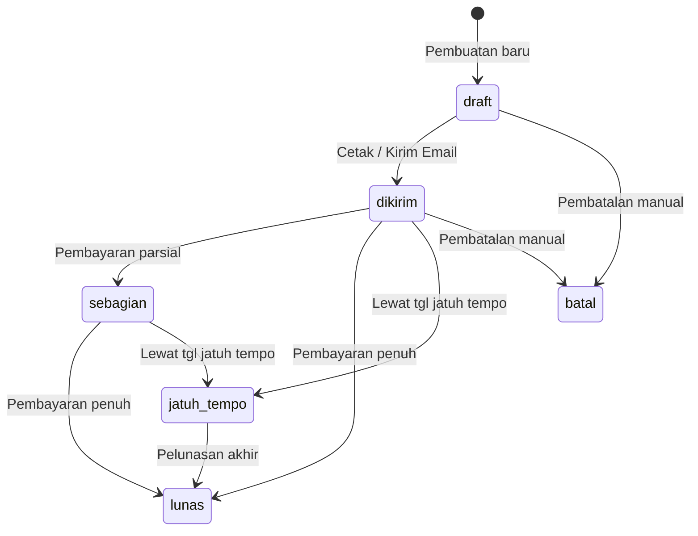

# 04 — Spesifikasi Modul Inti

Dokumen ini mendeskripsikan secara rinci alur kerja, logika bisnis, aturan validasi, dan integrasi antar modul dalam CRUDWorks ERP.

---

## 1. Modul Dashboard (`#/dashboard`)

### Tujuan
Menyediakan visibilitas operasional instan bagi pimpinan dan staf keuangan terhadap kondisi piutang, status penagihan bulan berjalan, dan aktivitas terkini.

### Komponen Tampilan
1. **Key Performance Indicators (Cards)**:
   - **Total Piutang Berjalan**: Akumulasi `sisa_tagihan` dari semua invoice berstatus `dikirim`, `sebagian`, dan `jatuh_tempo`.
   - **Tagihan Lunas Bulan Ini**: Total nominal pembayaran masuk pada bulan kalender aktif.
   - **Tagihan Jatuh Tempo (Overdue)**: Nilai nominal dan jumlah invoice yang melewati `tanggal_jatuh_tempo` dan belum lunas.
   - **Klien Aktif**: Jumlah entitas klien dengan status `aktif`.
2. **Grafik Pendapatan & Piutang (6 Bulan Terakhir)**:
   - Diagram batang/garis komparasi antara nilai invoice yang diterbitkan vs pembayaran yang terealisasi per bulan.
3. **Tabel Tagihan Mendesak (Urgent Attention)**:
   - 5 invoice overdue tertua dengan tombol aksi cepat ("Kirim Pengingat", "Lihat Invoice").
4. **Log Aktivitas Terkini**:
   - 5 aktivitas audit trail terbaru (misal: "Admin mencatat pembayaran INV-202611-0002").

---

## 2. Modul Pelanggan (`#/clients`)

### Fitur Utama
- **Pencarian dan Filter Cepat**: Filter berdasarkan status (Aktif, Prospek, Nonaktif) dan pencarian nama perusahaan, kontak, atau kota.
- **Form Data Pelanggan**:
  - Validasi email dan format nomor telepon.
  - Penomoran kode klien otomatis (`CLI-0001`, `CLI-0002`).
  - Rekam data NPWP dan alamat penagihan resmi untuk faktur.
- **Tab Profil & Ringkasan Klien**:
  - Informasi kontak dan alamat.
  - Daftar project aktif klien tersebut.
  - Riwayat seluruh invoice dan status pembayaran klien.
  - Total piutang historis akumulatif klien.

---

## 3. Modul Manajemen Project (`#/projects`) & Integrasi app-git

### Fitur Utama
- **Penetapan Project ke Klien**: Setiap project terhubung langsung ke satu `client_id`.
- **Integrasi app-git (`www/app-git`)**:
  - Kolom `git_repo_url`: URL remote repository Git (GitHub, GitLab, atau Git lokal).
  - Kolom `git_branch`: Branch target deployment (misal: `main` atau `production`).
  - Kolom `deploy_path`: Path folder kerja di sistem server lokal (`d:/laragon/www/{nama-folder}`).
  - Kolom `app_url`: Alamat akses aplikasi pelanggan yang di-deploy (misal: `http://clientapp.local/`).
  - Status Sinkronisasi: Membaca status deployment dari app-git (`last_deploy_status` dan `last_deploy_at`).
  - Shortcut langsung ke web deployment interface app-git untuk melakukan pull / rollback.

---

## 4. Modul Katalog Layanan (`#/services`)

### Fitur Utama
- Master harga standar untuk produk berulang maupun one-time.
- Kategori layanan: Hosting, Domain, Maintenance, Custom Development, Konsultasi.
- Siklus tagihan standar: Sekali Bayar, Bulanan, Triwulan, Semesteran, Tahunan.
- Integrasi ke Form Invoice: Memungkinkan operator memilih item layanan dari autocomplete untuk otomatis mengisi deskripsi dan harga satuan standar.

---

## 5. Modul Tagihan & Invoice (`#/invoices`)

### Siklus Status Invoice (State Machine)

### Format Penomoran Invoice
- Format standar: `INV-YYYYMM-XXXX` (contoh: `INV-202611-0001`).
- Penomoran dihasilkan otomatis oleh fungsi atomic `generateNo('INV-', 'invoices', 'nomor_invoice')`.

### Form Pembuatan Invoice
1. **Header**: Pemilihan Klien, Pemilihan Project (opsional), Tanggal Terbit, Tanggal Jatuh Tempo.
2. **Baris Item Dinamis**:
   - Dropdown layanan atau ketik deskripsi bebas.
   - Kolom Kuantitas, Harga Satuan, dan Subtotal kalkulasi otomatis.
   - Tombol Tambah Baris / Hapus Baris.
3. **Kalkulasi Finansial**:
   - Subtotal baris.
   - Diskon (Pilihan nominal flat IDR atau persentase).
   - PPN / Pajak (Persentase yang dapat dikonfigurasi, misal 11%).
   - Total Keseluruhan (Net Total).
4. **Catatan & Rekening**:
   - Catatan formal untuk dicetak di invoice (misal: "Pembayaran jatuh tempo 14 hari sejak tanggal terbit").
   - Pilihan rekening bank penerima default.

### Cetak PDF & Lembar Faktur
- Menggunakan engine layout HTML/CSS printable yang diintegrasikan dengan `window.print()` dan helper rendering jsPDF.
- Komponen dokumen tercetak:
  - Header logo instansi CRUDWorks & alamat lengkap.
  - Data penerima tagihan (nama perusahaan klien, UP penanggung jawab, alamat).
  - Tabel rincian layanan, kuantitas, harga, total.
  - Kotak instruksi transfer bank (nomor rekening, nama bank, pemilik rekening).
  - Tanda tangan digital / stempel instansi.

---

## 6. Modul Pembayaran (`#/payments`)

### Fitur Utama
- **Pencatatan Pembayaran**:
  - Pemilihan invoice yang masih memiliki `sisa_tagihan > 0`.
  - Sistem menampilkan nomor invoice, total tagihan, jumlah yang sudah dibayar, dan sisa kewajiban.
  - Input jumlah bayar (validasi: tidak boleh melebihi sisa tagihan).
  - Pemilihan kanal/metode bayar (BCA, Mandiri, Cash, dll).
  - Input nomor referensi transaksi bank dan unggah bukti transfer.
- **Otomasi Status**:
  - Jika `jumlah_bayar == sisa_tagihan`, status invoice otomatis berubah menjadi `lunas`.
  - Jika `jumlah_bayar < sisa_tagihan`, status invoice berubah menjadi `sebagian`.
- **Cetak Bukti Pembayaran (Kuitansi Resmi)**:
  - Menghasilkan tanda terima resmi pembayaran dengan nomor transaksi kuitansi unik (`PAY-YYYYMM-XXXX`).

---

## 7. Modul Tagihan Berulang / Recurring (`#/recurring`)

### Fitur Utama
- Mengotomatiskan penagihan biaya berkala untuk hosting, sewa server, perpanjangan domain, dan kontrak SLA maintenance bulanan.
- Jadwal fleksibel: Setiap tanggal tertentu tiap bulan atau setiap tahun.
- JSON Item Template: Menyimpan daftar layanan yang akan otomatis di-generate ke dalam invoice baru.
- **Eksekusi Otomatis**:
  - Script cron API (`api/cron.php?token=...`) berjalan harian.
  - Memeriksa record di tabel `recurring_invoices` yang memenuhi kriteria `berikutnya_dibuat_at <= CURDATE()` dan `status = 'aktif'`.
  - Membuat invoice baru secara otomatis, memperbarui kolom `terakhir_dibuat_at`, dan menghitung tanggal `berikutnya_dibuat_at` berikutnya sesuai frekuensi.

---

## 8. Modul Laporan Keuangan & Piutang (`#/reports`)

### Sub-Laporan Tersedia
1. **Laporan Aging Piutang (Umur Piutang)**:
   - Klasifikasi tagihan belum terbayar ke dalam bucket:
     - Belum Jatuh Tempo (Current)
     - Terlambat 1–30 Hari
     - Terlambat 31–60 Hari
     - Terlambat 61–90 Hari
     - Macet (>90 Hari)
2. **Laporan Pendapatan (Revenue Report)**:
   - Ringkasan penerimaan kas masuk per rentang tanggal berdasarkan kategori layanan dan metode pembayaran.
3. **Rekap Mutasi per Klien (Client Ledger / Statement of Account)**:
   - Histori debit (invoice diterbitkan) dan kredit (pembayaran diterima) untuk satu klien tertentu, menampilkan saldo piutang akhir.
4. **Fitur Ekspor**:
   - Kemampuan cetak langsung format cetak printer atau ekspor ke format Excel (CSV / Spreadsheet).

---

## 9. Modul Manajemen Pengguna & RBAC (`#/users`, `#/roles`)

### Fitur Utama
- Pengaturan akun staf internal (nama lengkap, username, email, kata sandi ter-hash `password_hash()`, role).
- Manajemen matriks izin akses (Role Permission Matrix):
  - Mengatur izin membaca, menambah, mengubah, atau menghapus per modul untuk setiap peran (Role).
  - Admin Role dapat mengaktifkan/menonaktifkan permission tertentu.
  - Perubahan hak akses langsung menginvalidasi cache Redis `rbac_perms_{role_id}` dan `rbac_menus_{role_id}` secara real-time.

---

## 10. Modul Pengaturan & Audit Trail (`#/settings`, `#/audit`)

### Fitur Utama
- **Profil Perusahaan**: Nama instansi, tagline, alamat, nomor telepon, logo instansi, NPWP perusahaan.
- **Konfigurasi Tagihan**: Format nomor invoice, jatuh tempo default (misal 14 hari), persentase PPN default, catatan kaki invoice standar.
- **Konfigurasi Email / SMTP**: Host SMTP, port, username, password, enkripsi (TLS/SSL), dan alamat pengirim notifikasi.
- **Jejak Audit (Audit Trail)**: Menampilkan catatan kronologis seluruh operasi CREATE, UPDATE, DELETE di sistem dengan detail user, IP address, waktu eksekusi, serta rekaman perubahan data lama vs data baru.
