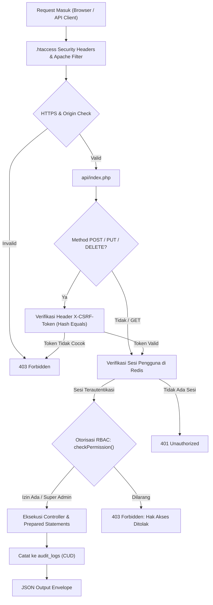

# 05 — Keamanan & Infrastruktur

Dokumen ini memuat standar keamanan teknis, proteksi terhadap serangan web modern, arsitektur manajemen sesi Redis, serta protokol validasi dan audit pada CRUDWorks ERP.

---

## 1. Arsitektur Keamanan Bertingkat



---

## 2. Proteksi Cross-Site Request Forgery (CSRF)

### Mekanisme Kerja
1. **Pembuatan Token**: Saat sesi login berhasil dibentuk, sistem menghasilkan string acak kriptografis 64 karakter:
   ```php
   $token = bin2hex(random_bytes(32));
   $_SESSION['csrf_token'] = $token;
   ```
2. **Pengambilan Token oleh Client**: Frontend memuat token via `GET /api/auth/csrf` saat boot atau menerima token dalam payload respons login.
3. **Penyematan Header**: Pada setiap permintaan yang mengubah state (`POST`, `PUT`, `DELETE`), helper `App.api()` secara otomatis menambahkan header HTTP:
   ```javascript
   headers['X-CSRF-Token'] = this.csrfToken;
   ```
4. **Verifikasi Server-side**: Middleware `api/middleware/csrf.php` mengevaluasi token menggunakan timing-safe string comparison:
   ```php
   if (!hash_equals($_SESSION['csrf_token'], $tokenFromHeader)) {
       http_response_code(403);
       echo json_encode(['success' => false, 'message' => 'Token CSRF tidak valid']);
       exit;
   }
   ```
5. **Endpoint yang Dikecualikan**: Hanya endpoint autentikasi publik tanpa state sebelumnya (`auth/login`) yang dilewati dari verifikasi token.

---

## 3. Matriks Otorisasi Berbasis Peran (RBAC)

Sistem menerapkan model RBAC dinamis yang tersimpan di database dan di-cache dalam Redis (`rbac_perms_{role_id}` dan `rbac_menus_{role_id}`).

### Daftar Kode Otoritas (Permissions)

| Kategori | Kode Izin | Nama Fitur | Admin | Staff Billing | PM | Viewer |
|---|---|---|:---:|:---:|:---:|:---:|
| **Dashboard** | `dashboard.view` | Melihat KPI & Grafik | Ya | Ya | Ya | Ya |
| **Pelanggan** | `client.view` | Melihat data pelanggan | Ya | Ya | Ya | Ya |
| | `client.create` | Menambah pelanggan baru | Ya | Ya | Ya | Tidak |
| | `client.edit` | Mengubah profil pelanggan | Ya | Ya | Ya | Tidak |
| | `client.delete` | Menghapus pelanggan | Ya | Tidak | Tidak | Tidak |
| **Project** | `project.view` | Melihat daftar project | Ya | Ya | Ya | Ya |
| | `project.create` | Menambah project | Ya | Tidak | Ya | Tidak |
| | `project.edit` | Mengubah detail project | Ya | Tidak | Ya | Tidak |
| | `project.git_sync` | Sinkronisasi status app-git | Ya | Tidak | Ya | Tidak |
| **Layanan** | `service.manage` | Kelola katalog harga | Ya | Ya | Tidak | Tidak |
| **Tagihan** | `invoice.view` | Melihat daftar tagihan | Ya | Ya | Ya | Ya |
| | `invoice.create` | Membuat faktur/invoice | Ya | Ya | Tidak | Tidak |
| | `invoice.edit` | Mengubah isi invoice | Ya | Ya | Tidak | Tidak |
| | `invoice.delete` | Membatalkan/hapus tagihan | Ya | Tidak | Tidak | Tidak |
| | `invoice.send` | Kirim invoice via email | Ya | Ya | Tidak | Tidak |
| **Pembayaran**| `payment.view` | Melihat riwayat bayar | Ya | Ya | Tidak | Ya |
| | `payment.create` | Mencatat pelunasan | Ya | Ya | Tidak | Tidak |
| **Recurring** | `recurring.manage`| Kelola tagihan otomatis | Ya | Ya | Tidak | Tidak |
| **Laporan** | `report.view` | Melihat laporan & ekspor | Ya | Ya | Tidak | Ya |
| **Sistem** | `user.manage` | Kelola operator & akses | Ya | Tidak | Tidak | Tidak |
| | `settings.edit` | Mengubah profil instansi | Ya | Tidak | Tidak | Tidak |
| | `audit.view` | Melihat log aktivitas | Ya | Tidak | Tidak | Tidak |

*Catatan: Super Admin (Role ID = 1) memiliki hak bypass mutlak pada seluruh middleware.*

---

## 4. Keamanan Sesi Berbasis Redis

Untuk performa tinggi dan isolasi sesi antar-proses:
1. **Penyimpanan**: Menggunakan ekstensi `phpredis` yang tersambung ke port lokal Redis `6379`.
2. **Karakteristik Cookie Sesi**:
   - `HttpOnly`: `true` (mencegah pencurian token via skrip XSS di browser).
   - `SameSite`: `'Lax'` (mencegah pengiriman cookie pada request lintas situs yang tidak sah).
   - `Lifetime`: 86.400 detik (24 jam waktu aktif).
3. **Pencegahan Concurrency Bottleneck**:
   - Pada request HTTP `GET` yang bersifat read-only, session lock segera dilepaskan dengan memanggil `session_write_close()` di baris awal `api/index.php`. Hal ini memungkinkan browser mengeksekusi multiple AJAX queries secara paralel tanpa terhalang antrean sesi.

---

## 5. Standar Validasi Input & Pencegahan Injeksi

1. **Prepared Statements**: Seluruh kueri SQL dieksekusi melalui instance singleton `Database` yang membungkus `PDO::prepare()` dan `PDO::execute()`. Dilarang keras melakukan konkatenasi variabel langsung ke dalam klausa SQL.
2. **Sanitasi Output**: Frontend menerapkan helper `App.escapeHtml()` pada setiap string dinamis yang dirender ke dalam `innerHTML` elemen DOM untuk meniadakan risiko DOM-based XSS.
3. **Validasi Tipe Data Numerik & Finansial**:
   - Kolom moneter diproses sebagai string berpresisi tetap atau diformat menggunakan `(float)` sebelum kalkulasi, lalu disimpan sebagai `DECIMAL(15,2)` pada MySQL.
   - Angka negatif pada kolom jumlah bayar atau nilai kuantitas secara eksplisit ditolak di level API controller.

---

## 6. Protokol Audit Trail

Setiap aksi penambahan (`INSERT`), perubahan (`UPDATE`), dan penghapusan (`DELETE`) pada tabel bisnis wajib memicu fungsi:
```php
logActivity($aksi, $tabel, $recordId, $oldData = null, $newData = null);
```
Fungsi ini merekam:
- `user_id`: ID operator yang sedang login dari sesi aktif.
- `ip_address`: Alamat IP klien (termasuk deteksi reverse-proxy headers bila ada).
- `user_agent`: Tipe browser / klien yang mengakses.
- `data_lama` & `data_baru`: Serialisasi JSON dari record sebelum dan sesudah perubahan untuk keperluan forensik data jika terjadi perselisihan saldo tagihan.
