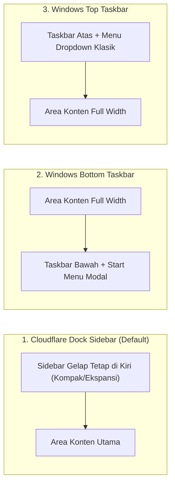

# 07 — Desain Antarmuka, Layout & PWA

Dokumen ini memuat spesifikasi desain antarmuka pengguna (UI), sistem tata letak (layout), kapabilitas Progressive Web App (PWA), serta mekanisme kustomisasi preferensi tampilan.

---

## 1. Filosofi Desain (Anti-AI Slop)

Desain CRUDWorks ERP mengedepankan fungsionalitas dan kejelasan informasi bagi staf keuangan dan manajer proyek:
- **Tipografi Berpresisi**: Menggunakan font **Inter** untuk teks antarmuka dan **IBM Plex Mono** untuk angka nominal finansial (tabular figures), nomor faktur, dan kode rekening agar angka tersusun rapi secara vertikal.
- **Hierarki Visual Jelas**: Batas elemen menggunakan garis tepi halus (`border-slate-200` / `border-slate-800`), bukan bayangan kartu tebal yang berlebihan.
- **Tingkat Kepadatan Data Efisien (Compact Financial View)**: Tabel data dirancang rapat namun nyaman dibaca, dengan baris belang halus (zebra striping) dan status badge berwarna pastel kontras tinggi.
- **Keterbacaan Mobile**: Ukuran font input form minimal 16px untuk mencegah zooming otomatis pada peramban iOS/Android saat form difokuskan.

---

## 2. Paradigma Tata Letak Navigasi (Layout Preferences)

Sistem menyediakan 3 opsi mode tata letak navigasi yang dapat dipilih operator melalui menu preferensi dan disimpan pada `localStorage.getItem('app_nav_layout')`:

### 2.1 Mode 1: Cloudflare Dock Sidebar (Default)
- **Karakteristik**: Mengadopsi gaya dashboard Cloudflare dengan latar belakang samping gelap (`bg-slate-900`), ikon Remix Icons berjarak rapi, serta indikator aktif bergaris vertikal di sisi kiri item.
- **Submenu Akordeon**: Menu induk yang memiliki anak (misal: Tagihan & Pembayaran) dapat dibuka-tutup dengan transisi halus tanpa me-refresh halaman.
- **Responsive Mobile**: Pada layar `< 1024px`, sidebar disembunyikan dalam drawer geser (slide-over) yang dipicu oleh tombol hamburger di header atas.

### 2.2 Mode 2 & 3: Windows-like Taskbar & Menu
- Mengadopsi standar komponen CSS termutakhir dari `app-keuangan`:
  - **Compact Dock Sidebar**: Sidebar ramping 64px dengan ikon, flyout submenu, dan organic tree lines.
  - **Bottom Taskbar**: Menempatkan bilah navigasi di bagian bawah layar menyerupai Windows 11. Tombol "Start" di sudut kiri membuka menu pop-up terstruktur dengan pinned cards dan grid aplikasi.
  - **Top Taskbar**: Menempatkan bilah di bagian atas dengan menu drop-down horizontal.
  - **Universal Datatable**: Kerapatan tabel dinamis (dense/spacious), freeze header, dan column quick search.

---

## 3. Sistem Palet Warna & Dark Mode

Sistem mendukung dark mode otomatis (mengikuti setelan sistem operasi) serta penguncian manual melalui tombol toggle di bilah atas.

| Token Warna | Light Mode | Dark Mode | Fungsi |
|---|---|---|---|
| `bg-main` | `#f8fafc` (slate-50) | `#0f172a` (slate-900) | Latar belakang dasar aplikasi |
| `card-bg` | `#ffffff` (white) | `#1e293b` (slate-800) | Panel kartu, tabel, dan formulir |
| `border-col`| `#e2e8f0` (slate-200) | `#334155` (slate-700) | Garis pemisah tabel dan input |
| `primary` | `#4f46e5` (indigo-600) | `#6366f1` (indigo-500) | Tombol aksi utama, tautan aktif |
| `success` | `#059669` (emerald-600) | `#10b981` (emerald-500) | Status lunas, verifikasi sukses |
| `warning` | `#d97706` (amber-600) | `#f59e0b` (amber-500) | Status sebagian, draft |
| `danger` | `#dc2626` (red-600) | `#ef4444` (red-500) | Tagihan jatuh tempo, aksi hapus |

---

## 4. Spesifikasi Progressive Web App (PWA)

Aplikasi dapat diinstal langsung ke homescreen ponsel Android/iOS atau desktop Windows/macOS sebagai standalone app tanpa bilah URL peramban.

### 4.1 Web App Manifest (`manifest.json`)
- `name`: "CRUDWorks ERP — Billing & Projects"
- `short_name`: "CRUDWorks"
- `display`: "standalone"
- `start_url`: "./index.html"
- `background_color`: "#0f172a"
- `theme_color`: "#4f46e5"
- `icons`:
  - `assets/icons/icon-192.png` (192x192, PNG, purpose: any maskable)
  - `assets/icons/icon-512.png` (512x512, PNG, purpose: any maskable)

### 4.2 Strategi Service Worker (`sw.js`)
- **App Shell Cache (Cache-First)**: Aset statis seperti `index.html`, stylesheet font, pustaka ikon, dan skrip core `assets/js/app.js` disimpan dalam cache untuk menjamin aplikasi terbuka instan (< 200ms).
- **API Network-First**: Permintaan dinamis ke endpoint `/api/*` selalu mengutamakan jaringan langsung. Jika perangkat offline, service worker mengembalikan fallback error terstruktur yang ditangani ramah oleh UI.

---

## 5. Komponen UI Standar

1. **Modal Dialog Helper (`App.modal`)**:
   - Menampilkan formulir popup atau konfirmasi hapus data dengan animasi backdrop blur.
2. **Toast Notification (`App.toast`)**:
   - Notifikasi mengambang di pojok kanan atas untuk umpan balik instan (sukses, peringatan, error).
3. **Table Data Helper (`App.renderTable`)**:
   - Menghasilkan tabel HTML otomatis lengkap dengan status skeleton loading, empty state ilustratif, header penyortiran kolom, dan navigasi paginasi.
4. **Print Engine Modal (`App.printInvoice`)**:
   - Area render khusus berukuran kertas A4 standar yang mengisolasi elemen tagihan dari elemen navigasi sistem saat dialog cetak browser (`Ctrl+P`) dipanggil.

---

## 5. Standar Proporsi UI, Area Aman Taskbar & Ergonomi Modal

1. **Area Aman Taskbar Bawah**: Kontainer utama `#app-content` wajib menyertakan `pb-24` agar baris terakhir tabel, pagination, atau tombol di bagian bawah tidak tertutup oleh taskbar mengambang.
2. **Batas Viewport Popover & Dropdown**: Seluruh menu mengambang (`table-menu.js`, `.dt-col-popover`, notifikasi) wajib memperhitungkan `safeBottom` (area taskbar) dan `max-h` agar tidak terpotong di tepi layar laptop maupun ponsel.
3. **Proporsi Tabel Padat**: Badge status, tanggal, nominal uang, dan tombol **Aksi** wajib memakai `whitespace-nowrap` + `align-middle`, sedangkan kolom teks panjang (nama proyek, email, URL) wajib memakai `max-w-[...]` dan `truncate` dengan atribut `title`.
4. **Sticky Footer pada Modal Panjang**: Modal form yang panjang wajib memakai struktur `max-h-[90vh] flex flex-col overflow-hidden` dengan header dan footer tombol **Simpan/Batal** tetap menempel (`shrink-0`), sementara hanya area isian form di tengah yang di-scroll.
5. **Konsistensi Toolbar Filter**: Input pencarian, dropdown filter, dan tombol ekspor wajib memakai tinggi seragam (`py-2 text-xs rounded-xl`) dengan `flex-wrap gap-2.5` agar rapi di berbagai lebar layar.
6. **Batas Popover Topbar di Layar Mobile**: Popover lonceng notifikasi dan menu profil pengguna wajib menyertakan `max-w-[calc(100vw-24px)]` dan `max-h-[calc(100vh-110px)] overflow-y-auto` agar tidak meluber di layar ponsel.
7. **Responsivitas Halaman Publik**: Halaman publik (`#/public-invoice`, `#/public-quotation`, `#/status`) wajib menjaga padding tepi yang lega dan tabel item dalam `overflow-x-auto`.
8. **Floating Action Menu & Flyout (`table-menu.js`)**: Baris tabel dengan banyak aksi dikelompokkan dalam tombol `Aksi` dengan menu melayang (`z-[105]`) dan submenu flyout (`z-[108]`) yang otomatis menghitung `safeTop` (mode `layout-top`), `safeBottom` (mode `layout-bottom`), dan `maxHeight` agar tidak tertutup taskbar maupun terpotong viewport.
9. **Sticky Header & Footer Modal**: Modal formulir panjang (seperti `#client-modal`, `#user-modal`, dan modal Portal Klien) wajib memakai `max-h-[90vh] flex flex-col overflow-hidden` dengan header/footer `shrink-0` dan area isi `overflow-y-auto flex-1 overscroll-contain`.
10. **Priority Color System (Minimalist Semantic Accent)**: Pada komponen ringkasan seperti **Action Board Pagi Hari**, dasar antarmuka menggunakan palet monokrom/slate bersih, sementara warna semantik hanya muncul secara terukur sesuai prioritas: `rose` untuk kondisi kritis/overdue/DOWN (`> 0`), `amber` untuk peringatan jatuh tempo/SLA, `primary` untuk peluang eksekusi/terbit faktur, dan `emerald` untuk aksi komunikasi WhatsApp atau status aman.
